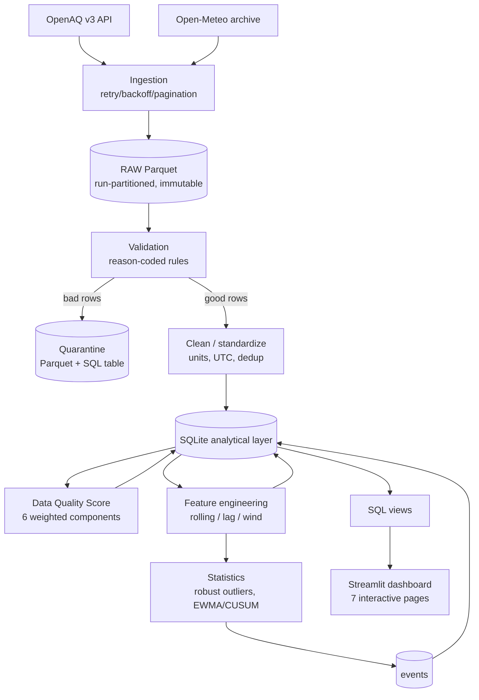

# Urban Air Quality Analytics & Data Quality Pipeline

An end-to-end, reproducible analytics system that ingests air-quality and weather
data, validates and quarantines it, scores its quality, engineers statistical
features, detects anomalies and sustained events, exposes a SQL analytics layer,
and serves an interactive Streamlit dashboard.

This is **not** an AQI calculator or a chart notebook. It is a small but realistic
internal data platform emphasizing data engineering, data quality, and robust
statistics.

---

## 1. Problem statement

Environmental monitoring networks produce messy, irregular, heavy-tailed hourly
time series. Naive pipelines silently drop bad rows, apply mean/std statistics
that break on skewed data, and report "the data is dirty" without quantifying it.
This project builds an auditable pipeline that:

- separates raw / clean / feature / quality / event data,
- quarantines bad records (never silently deletes) with explicit reason codes,
- computes a single transparent **Data Quality Score**,
- uses **robust** statistics (IQR, MAD, Hampel, EWMA, CUSUM) suited to the data,
- analyzes pollution–weather relationships with correlation, partial correlation,
  and interpretable regression,
- is reproducible, testable, restartable, and idempotent.

## 2. Architecture



Each layer writes a durable artifact, so the pipeline is restartable at any stage
and nothing lives only inside one in-memory DataFrame.

## 3. Data sources

| Source | What | Endpoint | Auth |
|---|---|---|---|
| OpenAQ **v3** | Air quality (PM2.5, PM10, NO2, SO2, CO, O3) | `https://api.openaq.org/v3` (`locations` → `sensors` → `sensors/{id}/measurements`) | `X-API-Key` header |
| Open-Meteo | Historical hourly weather | `https://archive-api.open-meteo.com/v1/archive` | none |

v1/v2 OpenAQ endpoints are retired and not used. Keys are read from `.env`
(`OPENAQ_API_KEY`); see `.env.example`. Secrets are never committed.

A **synthetic generator** (`scripts/generate_synthetic.py`, `source='synthetic'`)
lets the whole pipeline run offline for demos/tests. It is clearly labeled and is
never presented as real observations.

## 4. Data model

Relational schema (`src/sql/schema.sql`). Keys and grain:

| Table | Grain / natural key | Notes |
|---|---|---|
| `pipeline_runs` | `pipeline_run_id` (PK) | one row per run; full run summary |
| `stations` | `station_id` (PK) | dimension; referenced by facts |
| `air_measurements` | (`station_id`, `timestamp_utc`, `parameter`) | UNIQUE → idempotent |
| `weather_hourly` | (`city`, `timestamp_utc`) | weather modeled per city |
| `quality_metrics` | (`station_id`, `date`, `metric_name`, `rule_version`) | tidy/long; run_id = lineage only |
| `features_hourly` | (`station_id`, `timestamp_utc`, `pollutant`) | engineered features |
| `events` | `event_id` (PK) | sustained shifts, `evidence` JSON |
| `air_quarantine` | (`station_id`, `timestamp_utc`, `parameter`, `reason_code`) | rejected rows + reason |

Every fact row carries `pipeline_run_id` for lineage. Foreign keys link facts to
`stations`; broken references are a validation rule.

## 5. ETL flow

`ingest → raw → validate → quarantine → clean → load → quality → features → events`

- **Idempotent**: all loads are `INSERT … ON CONFLICT(natural key) DO UPDATE`, so
  re-running the same window never duplicates rows (verified by a test).
- **Modes**: `backfill` (explicit date window) and `incremental` (from last
  loaded timestamp).
- **Resilience**: retries with exponential backoff + jitter, HTTP 429 handling
  (honors `Retry-After`), pagination, min inter-request interval, timeouts.

## 6. Data quality design (one score)

Single **Data Quality Score** per (station, day):

```
Q = wC·C + wV·V + wU·U + wT·T + wF·F + wP·P ,   Σw = 1
```

| Component | Meaning |
|---|---|
| C Completeness | observed valid hours / expected hours |
| V Validity | share of received rows passing type/schema/domain parse |
| U Uniqueness | 1 − duplicates / received |
| T Temporal consistency | 1 − (gaps + non-monotonic) / expected |
| F Freshness | decay on age of latest observation |
| P Plausibility | 1 − (domain + stuck-sensor rows) / received |

Weights live in `config/quality_rules.yaml` and are a **defensible default, not a
universal standard**. Reason codes make every deduction auditable:
`MISSING_VALUE, DUPLICATE_RECORD, INVALID_TIMESTAMP, UNIT_MISMATCH,
DOMAIN_VIOLATION, STALE_DATA, TIME_GAP, PERSISTENT_CONSTANT, LOCAL_OUTLIER,
GLOBAL_OUTLIER` (+ schema/ref codes). "Station reliability" = this score read over
time, not a second score.

## 7. Statistical methods

| Method | Why / when | Module |
|---|---|---|
| IQR fences (1.5×, 3×) | skew-robust global outliers | `statistics/robust.py` |
| MAD modified z (0.6745·) | 50% breakdown point; resists masking | `robust.py` |
| Hampel (rolling median+MAD) | **local** spikes adapting to trend/season | `robust.py` |
| Rolling percentile envelope | context-aware (won't flag rush hour) | `robust.py` |
| EWMA + control limits | small **sustained** drifts | `shift.py` |
| CUSUM (k/h, persistence) | sustained mean shifts → events | `shift.py` |
| ACF/PACF, STL, rolling stats | temporal dependence, decomposition | `timeseries.py` |
| Pearson / Spearman / partial / lagged | pollution–weather association | `correlation.py` |
| OLS + HC3 robust SE, log target | interpretable multivariable model | `regression.py` |
| Bootstrap percentile CI | uncertainty (correct language) | `uncertainty.py` |
| Mann-Whitney / Kruskal + Holm + effect size | distribution comparisons | `hypothesis.py` |

Environmental data is **not i.i.d.**: strong autocorrelation and diurnal/weekly/
seasonal cycles mean we favor robust/rolling statistics and report effect sizes
alongside p-values. Correlation (partial or not) is association, **not causation**.

## 8. Dashboard

`streamlit run src/dashboard/app.py` — 7 pages: Overview, Trends, Distributions,
Weather relationships, Data Quality, Anomalies & Events, Stations. Controls
(city, station, pollutant, rolling window, EWMA λ, CUSUM threshold, anomaly
method, lag, confidence level) **recompute the underlying statistics**, not just
chart labels.

> Screenshots: run the dashboard locally and capture the pages. (Not committed.)

## 9. How to run

```bash
# 1. Create env + install
python -m venv .venv
.venv\Scripts\activate            # Windows (use source .venv/bin/activate on *nix)
pip install -r requirements.txt

# 2. Initialize DB (optional; the pipeline also does this)
python -m scripts.init_db

# 3a. Offline demo on synthetic data (no API key needed)
python -m scripts.run_pipeline --synthetic --mode backfill \
    --date-from 2024-01-01T00:00:00Z --date-to 2024-01-14T23:00:00Z

# 3b. Real data (set OPENAQ_API_KEY in .env first)
copy .env.example .env            # then edit
python -m scripts.run_pipeline --mode backfill --date-from 2024-06-01 --date-to 2024-06-14
python -m scripts.run_pipeline --mode incremental

# 4. Compute a metrics report
python -m scripts.report_metrics

# 5. Launch the dashboard
streamlit run src/dashboard/app.py
```

## 10. Testing

```bash
pytest -q
```

Covers deduplication, timezone/UTC flooring, unit normalization, null handling,
feature calculations, quality scoring, anomaly flags (incl. the MAD=0 edge case),
EWMA/CUSUM persistence, SQL views, and **idempotency** (double-run row counts).

## 11. Example computed results

Produced by `scripts/report_metrics.py`. Two reference runs are shown.

### 11a. Live OpenAQ v3 + Open-Meteo (2024-06-01 → 2024-06-07, 6 cities)

- Rows loaded: **2,416 air measurements**, 1,008 weather hours, **24 stations**.
- **Data Quality Score (mean overall): 80.3** — completeness **66.0** (real
  stations report irregularly and not every pollutant hourly — the pipeline
  quantifies this gap rather than hiding it), validity 100, uniqueness 100,
  temporal 98.9, plausibility 92.9, freshness 0.0 (historical window).
- Sustained events (CUSUM, ≥3h persistence): **52** (HIGH 24 / MEDIUM 19 / LOW 9).
- PM2.5 vs wind speed: Spearman ρ = **+0.19** (p=0.0013, n=280); partial r =
  **+0.14** controlling for temperature, humidity, hour. (Weak and site/season
  dependent — a reminder that real associations are noisy.)
- PM2.5 ~ weather OLS (log target, HC3): R² = **0.47**, Durbin-Watson 0.27
  (strong positive residual autocorrelation, as expected for hourly series).
- City PM2.5 differences (Kruskal-Wallis): H = **183.8**, p ≈ 1.2e-40, ε² =
  **0.43** (large effect) → cities differ significantly.

### 11b. Offline synthetic demo (reproducible without an API key)

- 15,841 air measurements, 2,016 weather hours, 12 stations; 334 quarantined
  (MISSING 233 / DOMAIN 54 / DUPLICATE 47); DQ Score 88.9; 114 CUSUM events;
  PM2.5–wind Spearman ρ = −0.42; city Kruskal-Wallis H = 1533.9 (ε² = 0.39).

## 12. Limitations

- SQLite is used for portability; at scale use Postgres/warehouse (see §13).
- Weather is modeled per city (nearest Open-Meteo grid), not per station.
- ppb/ppm→µg/m³ conversion uses standard conditions (25 °C, 1 atm), an approximation.
- Hourly rollups average sub-hourly readings; sub-hourly dynamics are lost.
- The synthetic generator is for demos/tests only, not scientific data.

## 13. Future improvements & scaling

- Migrate to Postgres: range-**partition** facts by month, index `(station_id,
  timestamp_utc)`, use BRIN on time; for 100M+ rows push aggregation into the
  warehouse (DuckDB/BigQuery) and materialize the views.
- Orchestrate with Airflow/Prefect; add great-expectations-style contracts.
- Spatial autocorrelation (Moran's I) and change-point detection modules.
- Backfill parallelism per station/sensor with checkpointing.

## 14. Project layout

```
air-quality-analytics/
  config/            YAML config (pipeline, cities, quality weights)
  src/
    common/          config, logging, IO, DB, reason codes
    ingestion/       HTTP client, OpenAQ v3, Open-Meteo, ingest jobs
    validation/      reason-coded rules + validator
    transform/       clean/standardize + feature engineering
    quality/         Data Quality Score
    statistics/      robust, timeseries, shift, correlation, regression,
                     uncertainty, hypothesis
    sql/             schema.sql, views.sql, named queries
    pipeline/        orchestrator (run ids, idempotency, modes, summary)
    dashboard/       Streamlit app + data access
  scripts/           init_db, run_pipeline, generate_synthetic, report_metrics
  tests/             pytest suite
  data/              raw/ processed/ quarantine/ (gitignored)
```
